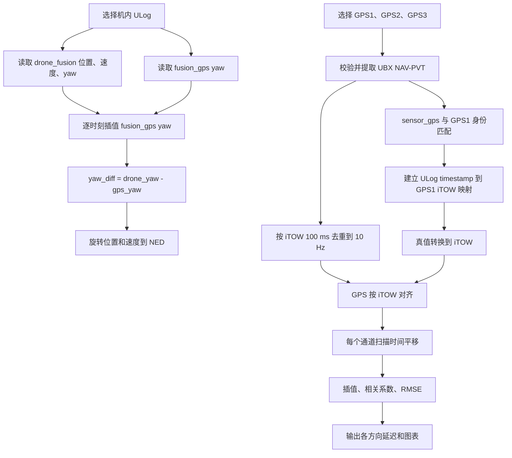

# GPS 与真值延迟计算流程

首次提交时间：2026-11-18 10:55:03（北京时间）。

[返回文档目录](01-工具使用说明.md)

## 目标

工具从机内 ULog 的 `drone_fusion` 构造真北 NED 速度真值，再与外部 GPS 原始 PVT 按 iTOW 对齐，最后为每个 GPS、每个通道估计延迟。当前主流程使用 ULog，不使用 FFC CSV。

## 总体流程



## 真值字段和 NED 旋转

读取 `drone_fusion.timestamp`、`position_x/y/z`、`velocity_x/y/z`、`yaw`，并读取 `fusion_gps.timestamp/yaw`。在每个 drone_fusion 时刻插值 fusion_gps yaw：

```text
yaw_diff(t) = drone_fusion.yaw(t) - fusion_gps.yaw(t)
psi(t) = -yaw_diff(t)
```

参考旋转矩阵：

```text
R(psi) = [ cos(psi)  -sin(psi)  0 ]
         [ sin(psi)   cos(psi)  0 ]
         [    0          0       1 ]
```

位置和速度都使用同一个逐时刻旋转：

```text
N = cos(psi) * X - sin(psi) * Y
E = sin(psi) * X + cos(psi) * Y
D = Z
```

旋转后的 `vel_n/e/d` 是延迟分析真值；水平速度为 `sqrt(vel_n^2 + vel_e^2)`。角度差先归一化到 `[-180 deg, 180 deg]`，避免正负 180 度跳变累积整圈。

界面提供“固定 yaw_diff(°)”输入框和“估计 yaw_diff”复选框，优先级为：固定值 > 速度序列估计（勾选时，默认勾选）> 逐时刻 `drone_fusion.yaw − fusion_gps.yaw`。实际旋转角均为 `−yaw_diff`。使用固定值或估计值时，允许 ULog 缺少 `fusion_gps` 航向话题。估计方法见 [yaw_diff 速度估计说明](06-yaw_diff速度估计说明.md)。

## sensor_gps 到 GPS1 的时间映射

不能把两个文件的第一条记录强行当成同一时刻。程序用同一接收机的 ULog `sensor_gps` 和 GPS1 PVT 建立映射：

1. 比较 `sensor_gps.veln/vele/veld` 与 GPS1 `vel_n/vel_e/vel_d`。
2. 速度按 0.001 m/s 四舍五入，并进一步检查经纬度。
3. 只保留唯一身份匹配。
4. 对每对匹配记录计算 `offset_i = GPS1_iTOW_i / 1000 - sensor_gps_timestamp_i / 1e6`。
5. 取一致匹配的 offset 中位数。
6. 转换真值时间：`truth_iTOW_ms = timestamp_us / 1000 + offset_ms`。

GPS2、GPS3 直接使用各自 iTOW 和共同真值时间轴对齐。

## GPS PVT 提取和 10 Hz 处理

程序搜索 UBX 同步字节 `B5 62`，读取帧长度，校验 UBX Fletcher 校验和，只接受 `NAV-PVT (class=01, id=07)`，并过滤无效定位和不合理经纬度，提取 iTOW、位置、N/E/D 速度、精度和卫星数。

如果接收机重复输出 50 Hz PVT，而原始导航解算频率是 10 Hz，程序按 100 ms iTOW 时间格去重，每个时间格只保留距离格点最近的一条原始 PVT。因此绘图、匹配和延迟计算使用 10 Hz 点。

## iTOW 对齐

对每个真值时刻寻找容差内最近 GPS iTOW：

```text
k = argmin |GPS_iTOW - truth_iTOW|
```

只有差值不超过界面容差（默认 200 ms）才算匹配成功。匹配数量是成功的真值时刻数，不是 GPS 独立输出点数。

## 延迟搜索和公式

每个 GPS、每个通道扫描 `-2000 ms` 到 `+2000 ms`，步长 `10 ms`。对候选延迟 `d`，在 `truth_time + d` 查询 GPS 插值值，然后去均值：

```text
a_i = truth_i - mean(truth)
b_i(d) = gps_interp_i(d) - mean(gps_interp(d))
```

单通道相关系数：

```text
corr(d) = sum(a_i * b_i) / sqrt(sum(a_i^2) * sum(b_i^2))
```

均方根误差：

```text
RMSE(d) = sqrt(mean((gps_interp_i(d) - truth_i)^2))
```

最佳延迟为 `argmax corr(d)`。正值表示 GPS 相对真值滞后，负值表示提前。

以上为 GPS 相对 ULog 真值的比较。GPS1 与 GPS2 之间的两路比较使用 20 ms 均匀网格重采样和 1 s 最大插值间隙，见 [两路 GPS 原始数据相对延迟计算](03-两路GPS原始数据相对延迟计算.md)。

### N/E 联合延迟

N/E 联合相关同样在有效重叠集合内去均值：

```text
truth_Nc = truth_N - mean(truth_N)
truth_Ec = truth_E - mean(truth_E)
gps_Nc   = gps_N   - mean(gps_N)
gps_Ec   = gps_E   - mean(gps_E)

corr_NE(d) = sum(truth_Nc * gps_Nc + truth_Ec * gps_Ec)
             / (sqrt(sum(truth_Nc^2 + truth_Ec^2))
                * sqrt(sum(gps_Nc^2 + gps_Ec^2)))
```

### 水平速度延迟

真值的水平速度由 `sqrt(vel_n^2 + vel_e^2)` 计算；GPS 侧使用 NAV-PVT 的水平地速字段 `speed`。对这个标量单独搜索，因此水平速度延迟与 N/E 联合延迟不同是正常的。

### 独立通道

程序分别计算速度 N、速度 E、速度 D、水平速度、位置 N、位置 E、位置 D 的延迟。每个通道有自己的最佳相关峰和 RMSE。

## 日志结果示例（中文释义）

```text
通过 ULog sensor_gps 与 GPS1 的导航记录身份匹配建立时间映射；GPS2、GPS3 共用 iTOW 时间基准。
GPS 1: 北东联合速度延迟=80 ms, 相关系数=0.87064
  速度 N: 延迟=80 ms, 相关系数=0.90048, RMSE=0.854276
  速度 E: 延迟=60 ms, 相关系数=0.84074, RMSE=1.02083
  速度 D: 延迟=100 ms, 相关系数=0.91956, RMSE=0.528216
  水平速度: 延迟=40 ms, 相关系数=0.95947, RMSE=0.652198
GPS 2: 北东联合速度延迟=200 ms, 相关系数=0.87530
  速度 N: 延迟=260 ms, 相关系数=0.86769, RMSE=0.979759
  速度 E: 延迟=180 ms, 相关系数=0.88587, RMSE=0.887339
  速度 D: 延迟=340 ms, 相关系数=0.72348, RMSE=0.888152
  水平速度: 延迟=180 ms, 相关系数=0.95719, RMSE=0.636704
参考：ULog drone_fusion NED
GPS 1：5282 点，匹配 20281 点
GPS 2：5465 点，匹配 20281 点
```

`5282 点`和`20281 点`不是矛盾：前者是 GPS 原始有效 PVT 数，后者是成功找到最近 GPS 样本的真值时刻数。

## 结果判读

相关峰适合判断相位延迟，RMSE 用于判断幅值是否接近。应同时检查 N/E 曲线峰谷是否主要水平平移、相关峰是否唯一、RMSE 是否合理。D 方向信号通常较弱，单独结果只作诊断。该延迟是相对于 ULog 真值和 sensor_gps 到 GPS1 iTOW 映射的相对延迟，不等于未经硬件时间戳校准的绝对串口或射频延迟。
