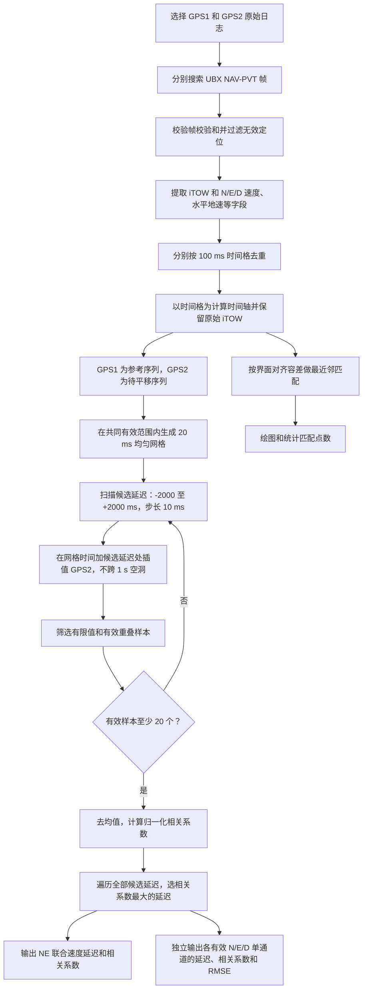

# 两路 GPS 原始数据相对延迟计算

首次提交时间：2026-11-18 11:19:47（北京时间）。

[返回文档目录](01-工具使用说明.md)

本文对应当前 `gps_delay_analyzer.py` 与 `pylib/gps_timing.py` 的实现。以 GPS1 为参考，估计 GPS2 相对 GPS1 的速度信号延迟，无需加载外部真值。文档统一使用 GPS1、GPS2 表示两路设备。

## 1. 计算流程图



延迟搜索使用两路去重后的数据，但会在共同有效时间范围内按 20 ms 均匀网格重采样；不使用绘图最近邻匹配后的数据。因此界面中的“对齐容差”影响绘图和匹配点数，不决定延迟搜索范围、搜索步长或相关系数。

## 2. 输入与预处理

### 2.1 原始数据提取

当前入口按 UBX 二进制内容解析，文件扩展名可以是 `.ubx`、`.log` 或其他二进制日志扩展名。只使用校验通过、长度不少于 92 字节的 NAV-PVT 帧，并要求：

- `0 < iTOW < 604800000`，单位为 ms。
- `fixType >= 3`，且定位有效标志置位。
- 经度和纬度在有效范围内。

提取的速度为北向、东向、地向速度 `vel_n`、`vel_e`、`vel_d`，单位由 mm/s 转换为 m/s。`speed` 直接读取 NAV-PVT 的水平地速字段并转换为 m/s，并非在本流程中重新计算。

### 2.2 100 ms 时间格去重

对每条原始记录的周内时间 \(t\)，计算时间格：

$$
b(t)=100\operatorname{round}\left(\frac{t}{100}\right)
$$

同一时间格中仅保留原始时间最接近格点的记录：

$$
t_b^*=\underset{t:b(t)=b}{\arg\min}\;|t-b|
$$

保留该记录的原始数值，以 \(b\) 作为后续计算的时间戳，同时将 \(t_b^*\) 保存在 `_source_itow_ms` 中。计算使用格点时间，未使用原始时间进行亚格点校正。这里的 10 Hz 是每 100 ms 最多保留一个点，缺测时间格不会自动补点。

## 3. 时间平移与插值

记 GPS1 的时间和信号为 \((t_i,x_i)\)，GPS2 的时间和信号为 \((s_j,y_j)\)。所有时间及候选延迟均使用 ms。

两路各取有效时间范围（首个到最后一个有限速度样本），求交集 \([T_{start},T_{end}]\)。在该区间内按 20 ms 步长生成均匀网格：

$$
g_k=T_{start}+k\,\Delta t,\qquad \Delta t=20\ \mathrm{ms},\qquad k=0,1,\ldots,K
$$

先把 GPS1 信号插值到网格 \(g_k\)。插值不外推；只有相邻原始样本间隔不超过 \(1\ \mathrm{s}\) 时才插值，否则该网格点无效。

候选延迟集合为：

$$
\mathcal D=\{-2000,-1990,\ldots,1990,2000\}
$$

共 401 个候选值。对于候选延迟 \(d\)，在以下时刻查询 GPS2：

$$
q_k(d)=g_k+d
$$

若 \(s_j\le q_k(d)\le s_{j+1}\)，且 \(s_{j+1}-s_j\le 1\ \mathrm{s}\)，线性插值为：

$$
\hat y_k(d)=y_j+\frac{q_k(d)-s_j}{s_{j+1}-s_j}(y_{j+1}-y_j)
$$

超出 GPS2 有效时间范围、或跨越超过 1 s 空洞的查询点返回无效值，不做外推。每个候选延迟分别筛选有效重叠样本，因此不同延迟的样本集合可能不同。

两路原始数据先按 100 ms 时间格去重到 10 Hz，再线性重采样到 20 ms 网格；更密的网格不会增加原始信息，只改变时间加权和参与相关的样本数。

## 4. NE 联合速度延迟

联合使用北向和东向速度：

$$
\mathbf x_i=\begin{bmatrix}v_{N,1}(g_i)\\v_{E,1}(g_i)\end{bmatrix},\qquad
\hat{\mathbf y}_i(d)=\begin{bmatrix}\hat v_{N,2}(g_i+d)\\\hat v_{E,2}(g_i+d)\end{bmatrix}
$$

先把两路信号插值到网格，再移除 N/E 任一分量为非有限值的网格点。对候选延迟 \(d\)，有效重叠集合记为 \(I_d\)，要求 \(|I_d|\ge20\)。在该集合内分别计算每个方向的均值：

$$
\bar{\mathbf x}_d=\frac1{|I_d|}\sum_{i\in I_d}\mathbf x_i,\qquad
\bar{\mathbf y}_d=\frac1{|I_d|}\sum_{i\in I_d}\hat{\mathbf y}_i(d)
$$

去均值后：

$$
\mathbf a_i=\mathbf x_i-\bar{\mathbf x}_d,\qquad
\mathbf b_i(d)=\hat{\mathbf y}_i(d)-\bar{\mathbf y}_d
$$

当前代码的联合归一化相关系数为：

$$
\rho_{NE}(d)=
\frac{\displaystyle\sum_{i\in I_d}\mathbf a_i^T\mathbf b_i(d)}
{\displaystyle\sqrt{\sum_{i\in I_d}\|\mathbf a_i\|^2}
\sqrt{\sum_{i\in I_d}\|\mathbf b_i(d)\|^2}+10^{-12}}
$$

最终联合延迟为：

$$
d_{NE}^*=\underset{d\in\mathcal D}{\arg\max}\;\rho_{NE}(d)
$$

输出北东联合速度延迟（程序字段 `NE lag`）和对应的相关系数（程序字段 `correlation`）。这是将 N/E 两方向一起计算的相关系数，不是两个单方向相关系数的平均值；变化能量较大的方向对结果影响更大。

## 5. 单通道延迟与 RMSE

对每个通道分别执行同一候选延迟搜索，并独立选择最优延迟。两路 GPS 互比输出 N/E/D 速度通道；水平地速 `speed` 只用于 GPS 相对 ULog 真值的比较，不在两路互比中估计。

| 通道 | 字段 | 单位 | 两路互比 |
| --- | --- | --- | --- |
| 北向速度 | `vel_n` | m/s | 输出 |
| 东向速度 | `vel_e` | m/s | 输出 |
| 地向速度 | `vel_d` | m/s | 输出 |
| 水平地速 | `speed` | m/s | 不输出 |

对标量信号，在有效重叠集合内去均值：

$$
a_i=x_i-\bar x_d,\qquad b_i(d)=\hat y_i(d)-\bar y_d
$$

$$
\rho_c(d)=\frac{\displaystyle\sum_{i\in I_d}a_i b_i(d)}
{\displaystyle\sqrt{\sum_{i\in I_d}a_i^2}\sqrt{\sum_{i\in I_d}b_i(d)^2}}
$$

单通道要求两路各自至少 20 个有限值样本，每个候选延迟至少有 20 个有效重叠样本，且分母不小于 \(10^{-12}\)。

$$
d_c^*=\underset{d\in\mathcal D}{\arg\max}\;\rho_c(d)
$$

在该通道自己的最优延迟处，计算原始数值差的 RMSE：

$$
\operatorname{RMSE}_c(d_c^*)=
\sqrt{\frac1{|I_{d_c^*}|}\sum_{i\in I_{d_c^*}}
\left[\hat y_i(d_c^*)-x_i\right]^2}
$$

单通道相关去均值，RMSE 不去均值；RMSE 单位与原始通道一致，因而包含固定偏差的影响。延迟按相关系数最大化选择，并非按 RMSE 最小化选择。

代码还尝试 `pos_n/e/d` 位置通道，但当前原始 PVT 解析不生成这些字段，因此两路原始 GPS 比较通常不会输出位置延迟，也不直接使用经纬度或海拔估计延迟。

## 6. 延迟正负与结果示例

由于 GPS2 在 \(g_i+d\) 处与 GPS1 的网格点 \(g_i\) 比较：

- \(d>0\)：GPS2 的相同信号特征出现在更晚时刻，表示 GPS2 相对 GPS1 滞后。
- \(d<0\)：GPS2 的相同信号特征出现在更早时刻，表示 GPS2 相对 GPS1 超前。
- \(d=0\)：当前搜索分辨率下，两路信号没有检出相对时间平移。

以下为输出内容的中文释义，数值仅作格式示意，不是实际日志测量结果。程序原始字段 `lag` 表示延迟，`corr` 或 `correlation` 表示相关系数，`RMSE` 表示均方根误差：

```text
GPS 2 相对 GPS 1: 北东联合速度延迟=230 ms, 相关系数=0.99800
  速度 N: 延迟=230 ms, 相关系数=0.99800, RMSE=0.02
  速度 E: 延迟=220 ms, 相关系数=0.99700, RMSE=0.03
```

联合延迟与各通道延迟可以不同，因为每个结果都独立搜索自己的相关系数峰值。

## 7. 当前实现的解释边界

- 结果是以 iTOW 标注的两路导航信号的相对延迟，不是串口传输耗时、主机接收耗时，也不能单独给出任一路相对真实运动的绝对延迟。
- 两路应使用一致的 iTOW 时间基准和速度坐标方向。当前两路比较没有额外估计时钟偏移、周跳变或坐标旋转。
- 10 ms 是搜索网格间隔，不代表实际测量精度达到 10 ms；结果受采样间隔、时间格化、插值、噪声和运动变化影响。
- 两路 GPS 比较的最大插值间隙为 1 s，超过该长度的空洞不会被跨越。真值比较仍使用原有线性插值，未限制最大间隙。
- 解析阶段会丢弃无定位历元，间隙由剩余有效样本的时间差判断；因此单个缺测历元仍可能被插值跨越，只有时间间隔超过 1 s 的空洞才会被拒绝。
- 两路 GPS 互比不输出水平地速 `speed` 通道；该通道只在 GPS 相对 ULog 真值的比较中估计。
- 两路比较先在 100 ms 去重数据上线性重采样到 20 ms 网格；更密的网格不增加原始信息，只影响时间加权和参与相关的样本数。
- 静止、近匀速或重复运动可能导致峰值不明确。当前没有相关系数置信阈值，也没有专门判断峰值是否落在搜索边界。
- 单通道没有有效结果时不输出该通道。NE 联合函数当前在所有候选延迟都不足 20 个重叠样本时可能返回 `延迟=-2000 ms, 相关系数=负无穷`；这应视为无有效估计，不能解释为真实延迟。
- 相关系数并列时，当前实现保留扫描顺序中较早的候选延迟，即较小的延迟值。

## 8. 对应代码入口

| 步骤 | 文件与函数 |
| --- | --- |
| 原始帧解析、校验与字段提取 | `gps_delay_analyzer.py` → `parse_ubx` |
| 读取原始日志、导出本地 PVT CSV | `gps_delay_analyzer.py` → `parse_gps` |
| 时间格去重 | `gps_delay_analyzer.py` → `decimate_pvt_10hz` |
| 绘图最近邻对齐 | `gps_delay_analyzer.py` → `align` |
| 两路比较调用与结果输出 | `gps_delay_analyzer.py` → `App._run` 内 `report_delay(..., uniform_grid=True)` |
| 均匀网格与间隙限制插值 | `pylib/gps_timing.py` → `_uniform_grid` / `interpolate_with_gap` |
| NE 联合延迟 | `pylib/gps_timing.py` → `estimate_delay` |
| 单通道延迟与 RMSE | `pylib/gps_timing.py` → `estimate_channel_delay` |

## 按光标区间重算

曲线窗口中 A、B 光标显示相对时间和区间长度。放置 A、B 后点击“按 A-B 光标区间重算指标”，会按该相对时间段关闭旧结果并重算主界面的指标，随后打开新的曲线窗口。该功能适用于延迟分析和两路/单路相对精度项目；区间选择只影响本次运行，不删除历史导出文件。
