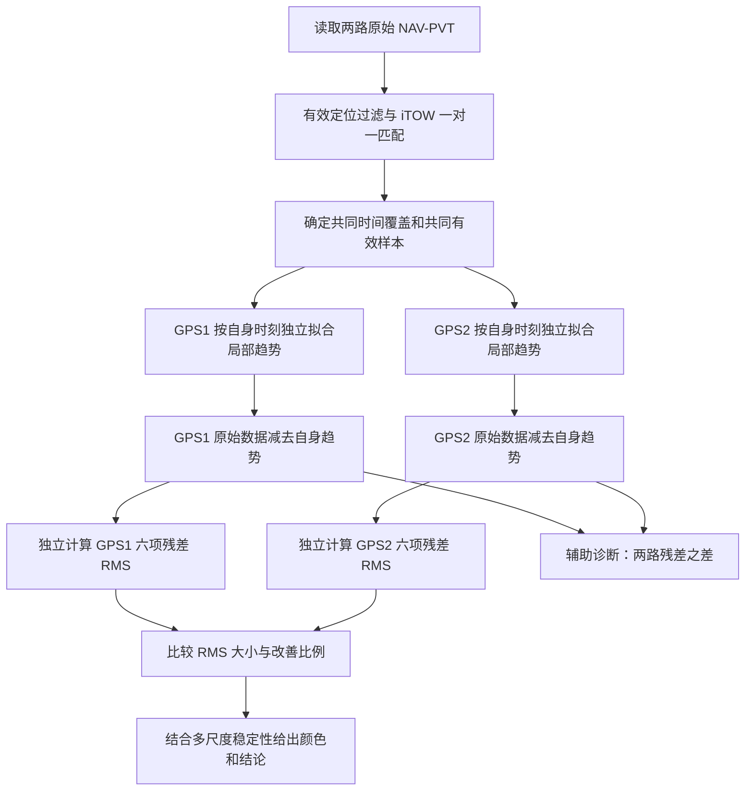

# GPS 相对精度对比：方法与结果说明

更新日期：2026-11-19。

[返回文档目录](01-工具使用说明.md)

> **一句话说明：在共同时间范围内对齐两路 GPS，分别独立去除局部运动趋势、计算各自残差 RMS，再比较指标差异，用于判断相同分析条件下哪一路输出的短时波动更小。**

## 1. 首先明确：主指标不是两路相减得到的

**本项目的主流程是“先对齐、各自独立计算、最后比较指标”，不是“GPS2 减 GPS1，再把差值分配成两路精度”。GPS1 仅是指标比较基准，不作为 GPS2 的真值。**

| 内容 | 如何计算 | 是否决定主表红绿判定 |
| --- | --- | --- |
| GPS1 主指标 | GPS1 减去自身拟合趋势，再计算 RMS | 是 |
| GPS2 主指标 | GPS2 减去自身拟合趋势，再计算 RMS | 是 |
| 改善比例 | 比较上面两个独立 RMS | 是，并结合多尺度检查 |
| 差分残差 RMS | 将两路去趋势残差相减后计算 RMS | **否，仅作辅助诊断** |
| 两路残差相关系数 | 比较两路残差同步变化的程度 | **否，仅作辅助诊断** |

**计算每一路的主指标不需要两路相减；各自的趋势拟合也不使用另一路的数值。** 共同样本筛选依赖两路的数据可用性，这是为了公平比较，并不表示将两路数据混合拟合。

## 2. 评估目标与结论边界

本项目适合回答：

> **同一段共同运动中，在相同分析时间尺度下，哪一路 GPS 的速度、位置输出短时波动更小，且这个排序是否稳定？**

它不能单独回答：哪一路绝对位置更准确，哪一路绝对速度更接近真实运动，或者每一路的真实测量噪声方差是多少。

原因是无独立真值时，观测只能写成：

$$
x_1(t)=s(t)+e_1(t),\qquad x_2(t)=s(t)+e_2(t)
$$

其中真实运动为 s，两路误差为 e1、e2。仅有两路观测，无法唯一确定这三个未知量。两路相减只能得到误差之差，也不能唯一确定各自误差。

**独立去趋势比直接统计运动数据的方差更符合短时波动比较的目标，但不是无真值条件下唯一或最正确的“真实精度估计”。残差小意味着在所选尺度下更平滑，不自动意味着更接近真值。**

例如，更强的接收机滤波可以降低残差，同时增加动态滞后；固定位置偏差、缓慢漂移也可能被局部趋势吸收。因此不能把绿色解释为绝对定位精度已经得到证明。

## 3. 公平比较的前提

**两路独立计算，必须使用统一分析条件。** 当前实现统一：

- 原始定位质量筛选规则。
- 共同记录区间及一对一时间匹配规则。
- 各尺度的时间窗长度和二次拟合阶数。
- 两路、六轴、全部分析尺度的共同有效样本集合。
- RMS 公式和颜色判定规则。

建议两路接收机刚性共载、天线距离接近，并覆盖同一段运动。若天线相距较大，旋转运动本身也可能导致不同的位置和速度，不能全部解释为 GPS 噪声。

当前匹配以 GPS1 时间顺序为起点，因此在采样频率不同、记录缺失或不规则时间戳条件下，交换两路顺序可能改变配对集合。比较不同测试时应保持顺序及参数一致。

## 4. 输入、过滤与时间对齐

### 4.1 原始 PVT

读取 UBX NAV-PVT，检查帧长度、校验和、定位有效性和经纬度范围。**仅接受 fixType 等于 3 且 gnssFixOK 有效的记录。**

不做 100 ms 时间格化，不改写原始 iTOW。同一文件相同 iTOW 的重复记录保留最后一条，防止重复发送增加统计权重。因此这里的输入点数是有效唯一 PVT 历元数，不是所有重复帧的数量。

三轴速度直接使用 PVT 的北向、东向、地向速度，单位 m/s。经纬度按 GPS1 首个匹配点建立共同局部原点，转换为北向和东向位移；地向位置为参考海拔减当前海拔，单位 m，向下为正。

### 4.2 一对一匹配

默认容差为 60 ms。按 GPS1 的 iTOW 从早到晚，检查 GPS2 中相邻的最近候选记录，选择未被使用且时间差不超过容差的一条：

$$
|t_{2,i}-t_{1,i}|\le\tau,\qquad \tau=60\ \mathrm{ms}
$$

同一条 GPS2 记录不重复使用，不插值扩充统计样本。两路拟合分别使用自身实际采样时间，不把 GPS2 时间强制改成 GPS1 时间。该顺序匹配不是全局最优配对算法。

### 4.3 iTOW 对齐不等于延迟补偿

**按 iTOW 匹配，只保证导航时间相近；不保证两路相同运动特征完全重合。当前相对精度项目不自动补偿接收机相对延迟。**

整体固定时移对长记录中独立去趋势 RMS 的影响通常较小，但在急转弯、区间边界和缺测附近会影响两路是否覆盖同一运动阶段。若原始曲线存在明显错位，应结合延迟项目检查，不能认为 iTOW 匹配已经消除了动态响应差异。

## 5. 各自独立去趋势的公式

### 5.1 六项序列

对接收机 g（GPS1 或 GPS2）的以下六个序列分别处理：

| 序列 | 含义 | 单位 |
| --- | --- | --- |
| 速度 N | 北向速度 | m/s |
| 速度 E | 东向速度 | m/s |
| 速度 D | 地向速度 | m/s |
| 位置 N | 共同原点下北向位移 | m |
| 位置 E | 共同原点下东向位移 | m |
| 位置 D | 共同原点下地向位移 | m |

以下用 xg 表示其中任意一个序列。每路、每轴独立拟合，没有将 GPS1、GPS2 平均后作为共同真值。

### 5.2 居中滑动窗口

主窗口默认 W=3 秒，即中心前后各 1.5 秒。在该路中心时刻 tgi 附近选择：

$$
J_{g,i}=\left\{j:\left|t_{g,j}-t_{g,i}\right|\le\frac W2\right\}
$$

相对时间归一化为：

$$
u_{g,ij}=\frac{t_{g,j}-t_{g,i}}{W/2}
$$

### 5.3 二次最小二乘趋势

$$
(a_{g,i},b_{g,i},c_{g,i})=
\underset{a,b,c}{\arg\min}\sum_{j\in J_{g,i}}
\left[x_g(t_{g,j})-(a+b u_{g,ij}+c u_{g,ij}^2)\right]^2
$$

中心点的相对时间为零，因此局部趋势值是截距：

$$
\hat s_g(t_{g,i})=a_{g,i}
$$

**每个点都有自己的窗口和趋势，不是用一条二次曲线拟合整段飞行。** 局部常量、线性和二次变化可以被模型吸收，更高阶真实运动则可能残留。

### 5.4 独立残差

$$
r_{1,i}=x_1(t_{1,i})-\hat s_1(t_{1,i}),\qquad
r_{2,i}=x_2(t_{2,i})-\hat s_2(t_{2,i})
$$

这一步才是本项目的“去趋势”。**先分别得到两路残差，再分别统计；不是先计算 GPS2−GPS1。**

## 6. 有效窗口与实际统计点数

每个窗口必须同时满足：至少 11 个样本；中心两侧各覆盖不少于总窗口长度的 40%；窗口内相邻样本间隔不超过 0.5 秒。

最终只采用两路六轴在所有分析尺度均有效的共同配对索引集合 I：

$$
n=|I|
$$

六项主指标使用同一组 n 个配对点；每路各贡献 n 个残差样本。首尾、数据空洞附近可能被排除，界面显示实际 n 和两路实际起止 iTOW。

**n 是参与计算的残差样本数，不是统计上独立的噪声样本数。** 相邻滑窗重叠，残差及原始 GPS 误差都可能存在时间相关性。

## 7. 主指标：独立 RMS、差值与改善比例

对于任一速度或位置方向 k：

$$
R_{1,k}=\sqrt{\frac1n\sum_{i\in I}r_{1,k,i}^2},\qquad
R_{2,k}=\sqrt{\frac1n\sum_{i\in I}r_{2,k,i}^2}
$$

这里不再扣除整段残差均值，也不进行噪声自由度校正，所以名称是残差 RMS，不是原始数据方差或严格无偏噪声标准差。

两路指标差可以理解为：

$$
\Delta R_k=R_{2,k}-R_{1,k}
$$

当前主表显示两路 RMS 和改善比例，不单独设置差值列：

$$
\mathrm{改善比例}_k=\frac{R_{1,k}-R_{2,k}}{R_{1,k}}\times100\%
$$

例如 0.20 m/s 与 0.15 m/s 对应改善 +25%；0.20 m/s 与 0.30 m/s 对应改善 −50%。基准 RMS 接近零时不计算百分比。

## 8. 多尺度稳定性与红绿判定

**单个窗口较小的 RMS 不应立刻被解释为稳定优胜。** 当前自动使用三个尺度：

$$
\mathcal W=\left\{\max(1,2W/3),\ W,\ \min(30,5W/3)\right\}
$$

重复尺度去重。主窗口 3 秒对应 2、3、5 秒；主窗口允许 1～30 秒。

所有尺度使用第 6 节相同的共同样本。主表 RMS 是主窗口结果，附加列显示所有尺度改善比例的最小值至最大值。

| 判定 | 条件 | 含义 |
| --- | --- | --- |
| 绿色 | 所有尺度 GPS2 的改善比例均大于 +5% | GPS2 多尺度更平滑 |
| 红色 | 所有尺度 GPS2 的改善比例均小于 −5% | GPS2 多尺度波动更大 |
| 灰色 | 其余情况，包括差异小、排序变化或无法计算比例 | 不给出稳定优劣结论 |

**5% 是减少微小差异误判的工程阈值，不是统计显著性或置信区间。** 即使所有尺度都绿色，也只能说明在这些尺度下更平滑，不能证明绝对精度更高。

短窗口容易跟随真实运动，也可能吸收部分噪声；长窗口更容易将慢变化和高阶运动计入残差。多尺度检查用于识别这一依赖，不是为结果选择有利窗口。

## 9. 辅助差分与相关性：只诊断，不分配各路噪声

两路残差之差及其 RMS 为：

$$
d_{k,i}=r_{2,k,i}-r_{1,k,i},\qquad
R_{diff,k}=\sqrt{\frac1n\sum_{i\in I}d_{k,i}^2}
$$

它衡量两路短时波动的不一致程度，**不参与主指标的独立拟合或颜色判定**。差分小不代表两路都准确，两路共同偏离真值也可以使差分很小。

各尺度同时导出残差相关系数：

$$
\rho_k=\frac{\sum_i(r_{1,k,i}-\bar r_{1,k})(r_{2,k,i}-\bar r_{2,k})}
{\sqrt{\sum_i(r_{1,k,i}-\bar r_{1,k})^2}\sqrt{\sum_i(r_{2,k,i}-\bar r_{2,k})^2}}
$$

较强相关性可能来自共同运动残留、共同环境误差或其他相关因素，不能单独确定原因。残差近似常量时相关系数无定义，输出空的数值结果。

不能直接将差分 RMS 除以根号二当作某一路真实噪声；这需要独立、等方差且共同运动完全抵消等额外假设，当前不作这些假设。

## 10. 去趋势图怎么读

“去势图”在本项目中准确名称是**去趋势残差图**。曲线窗口共十二页，六项原始数据与各自残差交替展示。

| 页面 | 纵轴含义 | 主要用途 |
| --- | --- | --- |
| 速度 N/E/D | 原始速度，m/s | 看共同运动和明显时间错位 |
| 位置 N/E/D | 共同原点下局部位移，m | 看轨迹分量、位置偏置和慢变化 |
| 速度去趋势残差 | 原始速度减自身局部趋势，m/s | 看各路短时速度波动 |
| 位置去趋势残差 | 局部位置减自身局部趋势，m | 看各路短时位置波动 |

横轴为各路实际 iTOW 减公共显示起点后的秒数。**残差零线表示“与自身局部趋势一致”，不表示真实速度为零、位置为零或测量误差为零。** 正残差表示高于自身趋势，负残差表示低于自身趋势。

例如原始北向速度 10.20 m/s、局部趋势 10.00 m/s，残差显示 +0.20 m/s。若共同运动增加到 20 m/s，且局部趋势正确跟随，仍只统计偏离趋势的部分，不会把 20 m/s 本身当作噪声。

波动整体越小通常对应 RMS 越小；单次大尖峰也会增加 RMS。如果两路在转弯时同时出现同向尖峰，应考虑真实运动没有完全去除；若只有一路跳变，应检查原始记录和状态，但不能仅凭曲线认定原因。

图中不额外叠加趋势线，趋势等于原始值减残差。所有页面只显示共同有效窗口中心样本；首尾或空洞附近缺点与统计筛选一致。连接线及光标插值只是显示效果，不增加统计样本。支持滚轮缩放、双光标、平移和图片保存。

## 11. 使用与导出

运行主脚本，选择“GPS 相对精度对比”，填写两路日志路径，设置窗口长度和匹配容差，点击开始。无需 ULog 或自定义图例。结果显示在主表，并弹出曲线窗口。

结果保存在项目根目录的 analysis_output：

| 文件 | 内容 |
| --- | --- |
| relative_accuracy_时间戳.csv | 六项主窗口 RMS、改善比例、结论、差分 RMS、共同点数、多尺度改善范围 |
| relative_accuracy_时间戳_residuals.csv | 每对样本的两路实际 iTOW 及六轴主窗口残差 |
| relative_accuracy_时间戳_scales.csv | 每项每尺度的共同点数、两路 RMS、改善百分比和残差相关系数 |

文件路径和参数保存到本地历史配置。新计算会清理旧界面结果及旧图窗，不删除磁盘上已导出的文件。

## 12. 真实日志验证与结果解读

以 log/42-重回复杂环境 下的 gps_log.ubx 为 GPS1、pvt.log 为 GPS2，主窗口 3 秒、辅助尺度 2/5 秒。当前多尺度共同样本口径下：

| 指标 | GPS1 主窗口 RMS | GPS2 主窗口 RMS | 多尺度结论 |
| --- | --- | --- | --- |
| 速度 N（m/s） | 0.280890 | 0.530120 | 红色，GPS2 波动更大 |
| 速度 E（m/s） | 0.290956 | 0.517151 | 红色，GPS2 波动更大 |
| 速度 D（m/s） | 0.294722 | 0.695282 | 红色，GPS2 波动更大 |
| 位置 N（m） | 0.0960481 | 0.0961910 | 灰色，排序随尺度变化 |
| 位置 E（m） | 0.110014 | 0.100961 | 灰色，最小改善约 3%，未超过阈值 |
| 位置 D（m） | 0.192540 | 0.119456 | 绿色，GPS2 多尺度更平滑 |

结果仅针对这些文件与设置。位置 N/E 的灰色不是软件未计算，而是有意避免强行排序。各项最终数值应以本次运行输出为准。

## 13. 最后应当如何表述结论

推荐表述：**“同运动条件下，GPS2 的 D 向位置去趋势残差在 2、3、5 秒尺度均小于 GPS1，说明其该尺度下短时位置输出更平滑。”**

不推荐表述：“GPS2 的绝对位置精度已经证明优于 GPS1”或“残差就是每路真实噪声”。

若要进一步判断接近真值的程度，应增加独立参考、已知静止点或可验证的运动约束，并检查动态延迟。当前方法的价值是：**没有真值时，以统一条件、独立计算和多尺度稳定性，提供可复查的短时波动比较证据，而不是构造不存在的真值。**

## 单 GPS 独立统计模式

只填写 GPS1 或只填写 GPS2 文件均可启动。此时不需要另一份日志、不做时间配对，直接在该文件自身 fixType=3 有效唯一 PVT 上独立去趋势。仍使用主窗口及辅助尺度共同有效样本，输出六轴残差 RMS、STD、绝对残差 P50/P95、最大绝对残差、有效点数及多尺度 RMS 范围。

主表自动切换为单路指标列，全部使用中性色，不显示改善比例、差分或优劣结论。自动打开该路六轴原始值及去趋势残差的十二页曲线。只填写 GPS2 时图中仍标为 GPS2，不改成 GPS1。

单路模式不使用匹配容差；CSV 文件以 `relative_accuracy_single_` 开头，包含汇总、逐点原始值与残差、多尺度 RMS。输入两路后自动恢复原有相对对比模式。单路输出仍是短时波动指标，不是绝对精度。

## 按光标区间重算

延迟分析和 GPS 相对精度对比的曲线窗口中，A、B 光标读数使用相对时间，显示 A、B 的相对秒数及区间长度。放置两个光标后点击“按 A-B 光标区间重算指标”，程序会关闭当前旧图窗和旧结果，按该相对时间区间重新解析并计算，再更新主界面指标表、日志和新曲线窗口。A、B 顺序不影响区间，超出数据范围或没有两个光标时不会启动重算。

GPS 相对精度单文件模式也支持该按钮；重新计算仍只统计该文件自身数据，不产生两路优劣颜色。双文件模式继续使用原有一对一匹配、独立去趋势和多尺度规则。导出的文件会生成新的时间戳版本，旧磁盘文件不会删除。
